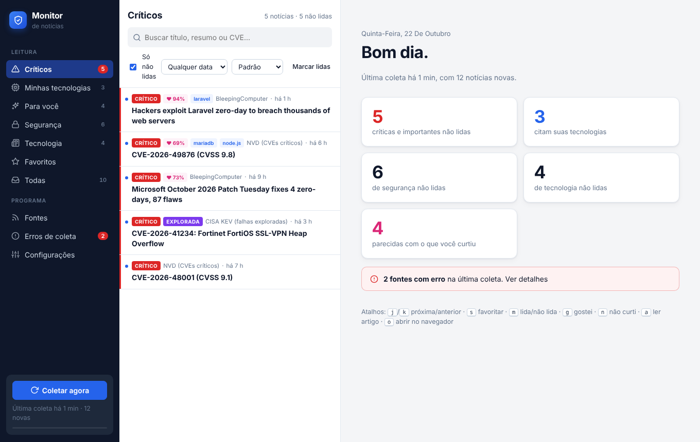
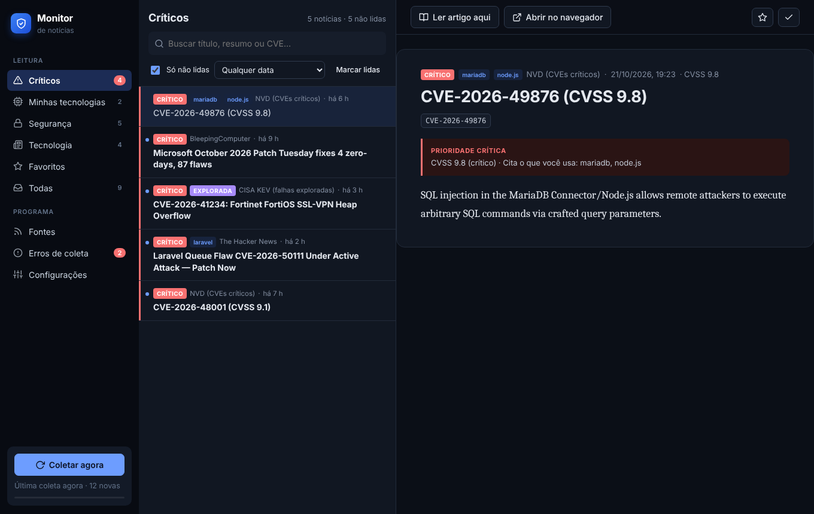
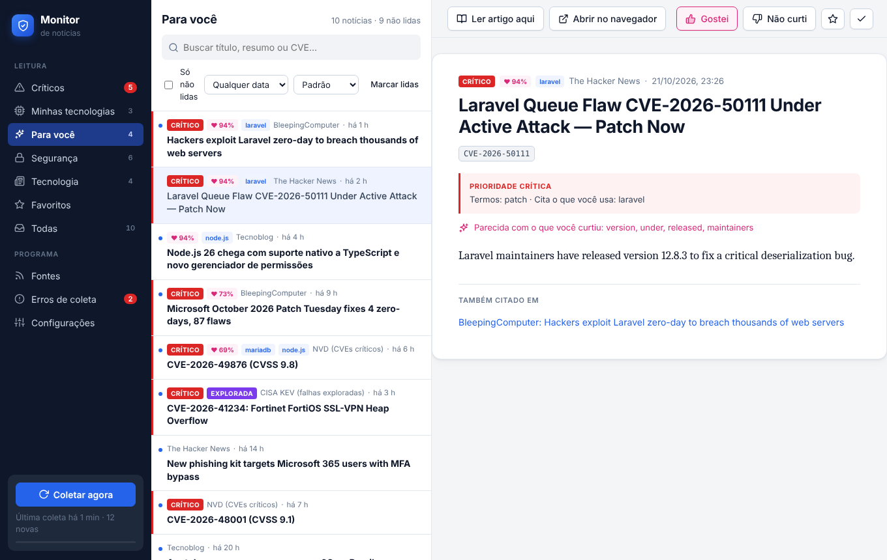
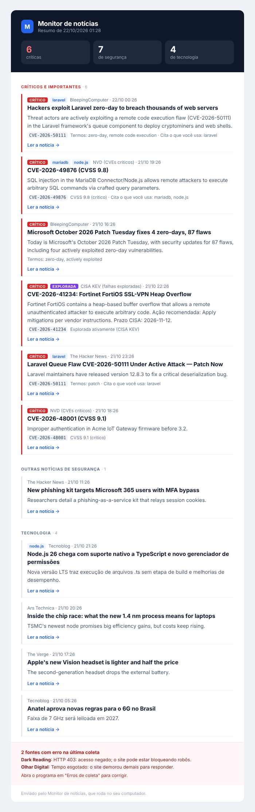

# Monitor de notícias

Programa local (Windows e Linux) que busca notícias de tecnologia em vários sites, coloca no topo as
**vulnerabilidades críticas** que você precisa corrigir e mostra tudo num leitor próprio. Também envia um
resumo bonito por e-mail.



## O que ele faz

- **Coleta** 25 fontes de uma vez (RSS e APIs oficiais): CISA KEV, NVD, GitHub Advisories, Microsoft MSRC,
  CERT.br, BleepingComputer, The Hacker News, Ars Technica, Hacker News, Tecnoblog e outras.
- **Prioriza** cada notícia: falhas já exploradas (CISA KEV), CVSS 9 ou mais, termos como *zero-day* e
  *RCE*, e qualquer menção às tecnologias que você usa (PHP, MariaDB, Laravel, Node.js...).
- **Aprende seu gosto**: marque notícias com *Gostei* ou *Não curti* e a aba **Para você** passa a ordenar
  as novas pelo que você curtiu. Tudo calculado no seu computador.
- **Leitor próprio**: abas por assunto, busca, favoritos, atalhos de teclado, tema claro/escuro e leitura do
  artigo completo dentro do programa (sem anúncios nem scripts do site).
- **Agrupa** a mesma falha citada por vários sites ("Também citado em").
- **Relatório de erros**: mostra quais sites falharam, por quê e há quantas coletas, com botão para corrigir.
- **Fontes editáveis**: inclua, edite, desative, remova e teste sites pelo programa. Cole o endereço de um
  site e ele procura o feed sozinho; sites sem RSS podem ser lidos com seletores CSS.
- **E-mail**: resumo em HTML pelo Outlook, Microsoft 365, Gmail, Yahoo ou qualquer SMTP.

| Leitor (tema escuro) | Para você |
| --- | --- |
|  |  |

## Instalação

Precisa do [Python 3.10 ou mais novo](https://www.python.org/downloads/). No Windows, marque
"Add Python to PATH" ao instalar.

```bash
git clone https://github.com/Nerqs/monitor-noticias.git
cd monitor-noticias
```

**Windows:** dê dois cliques em `iniciar.bat`.
**Linux:** rode `./iniciar.sh`.

Na primeira vez o script cria um ambiente virtual (`.venv`) e instala as dependências. Depois disso abre
direto.

No Linux, a janela própria usa GTK ou Qt. Se ela não abrir, o programa usa o navegador automaticamente. Para
ter a janela, instale um dos dois:

```bash
sudo apt install python3-gi gir1.2-webkit2-4.1   # GTK (Debian/Ubuntu)
# ou
.venv/bin/pip install "pywebview[qt]"            # Qt
```

## Uso

| Comando | O que faz |
| --- | --- |
| `python run.py` | Abre o leitor |
| `python run.py --coletar` | Abre o leitor e já começa a coletar |
| `python run.py --so-coletar` | Coleta sem abrir janela e mostra o resultado no terminal |
| `python run.py --so-coletar --email` | Coleta e envia o resumo por e-mail |
| `python run.py --navegador` | Usa o navegador em vez da janela própria |

Os scripts `iniciar.bat` e `iniciar.sh` aceitam os mesmos parâmetros.

**Atalhos no leitor:** `j`/`k` próxima/anterior, `g` gostei, `n` não curti, `s` favoritar,
`m` lida/não lida, `a` ler artigo aqui, `o` abrir no navegador.

### Rodar sozinho de manhã (opcional)

- **Windows:** Agendador de Tarefas → Criar tarefa básica → programa
  `C:\caminho\monitor-noticias\.venv\Scripts\python.exe`, argumentos `run.py --so-coletar --email`,
  "Iniciar em" `C:\caminho\monitor-noticias`.
- **Linux:** `crontab -e` e adicione
  `0 7 * * 1-5 cd ~/monitor-noticias && .venv/bin/python run.py --so-coletar --email`.

## E-mail

Em **Configurações → E-mail**, escolha o provedor (os campos do servidor são preenchidos sozinhos),
informe seu e-mail, os destinatários e salve a senha. A senha fica no cofre do sistema (Gerenciador de
Credenciais no Windows, chaveiro no Linux), nunca em arquivo. Sem cofre disponível, defina a variável de
ambiente `MONITOR_SMTP_PASSWORD`.

Use **Enviar e-mail de teste** para conferir e **Pré-visualizar resumo** para ver como fica.



**Outlook / Hotmail:** a Microsoft vem desligando o login por senha simples (SMTP AUTH) em várias contas.
Se o teste falhar com erro de autenticação, ative a verificação em duas etapas e crie uma
[senha de aplicativo](https://account.live.com/proofs/AppPassword). Em contas de empresa (Microsoft 365),
o administrador precisa liberar o SMTP AUTH para a sua caixa. Se nada disso for possível, use o Gmail (com
[senha de app](https://myaccount.google.com/apppasswords)) ou outro provedor.

## Fontes

Em **Fontes** você pode:

- **Adicionar**: cole o endereço do site e clique em *Procurar feed*. Se o site não tiver RSS, escolha
  *Página sem RSS* e informe os seletores CSS (use F12 → Inspecionar no navegador para achá-los).
- **Testar** antes de salvar: mostra quantas notícias vieram e alguns exemplos.
- **Editar, desativar ou remover** qualquer fonte.

A lista fica em `data/sources.yaml` e também pode ser editada à mão.

### Chaves opcionais

- **NVD:** sem chave a API aceita poucas consultas por minuto. Uma chave gratuita
  ([pedir aqui](https://nvd.nist.gov/developers/request-an-api-key)) evita erros 403/429.
- **GitHub:** um token sem permissões extras aumenta o limite da API de advisories.

## Como a prioridade é calculada

Cada notícia ganha pontos e vira **Crítico** (70+), **Alto** (40+) ou normal:

| Sinal | Pontos |
| --- | --- |
| Está no catálogo de falhas exploradas da CISA (KEV) | +60 |
| CVSS 9 ou mais / 7 ou mais | +45 / +25 |
| Termo crítico (zero-day, RCE, actively exploited...) | +50 |
| Cita uma tecnologia sua numa notícia de segurança | +35 |
| Fonte de segurança | +20 |
| Termo de segurança (vulnerability, patch, malware...) | +12 |

Os termos e as tecnologias são editáveis em **Configurações**. Em **Para você**, a ordem vem de um modelo
Naive Bayes treinado com as suas curtidas (ativa a partir de 3 curtidas).

## Onde ficam os dados

Tudo fica na pasta `data/` ao lado do programa (ou na pasta definida em `MONITOR_DATA_DIR`):
`monitor.db` (notícias, curtidas, erros), `config.yaml` e `sources.yaml`. Nada é enviado para fora além das
consultas aos sites e do e-mail.

## Desenvolvimento

```bash
python -m venv .venv
.venv/bin/pip install -r requirements.txt pytest
.venv/bin/python -m pytest
```

Estrutura:

```
monitor/
  fetchers.py     coletores (RSS, CISA KEV, NVD, GitHub, raspagem) e leitura de artigo
  scoring.py      prioridade de cada notícia
  preferences.py  aprendizado com Gostei / Não curti
  pipeline.py     coleta completa em paralelo
  db.py           banco SQLite
  emailer.py      resumo por e-mail
  web.py          API local usada pelo leitor
  templates/      leitor e e-mail (HTML)
  static/         estilo e JavaScript do leitor
  defaults/       configuração e fontes iniciais
```
